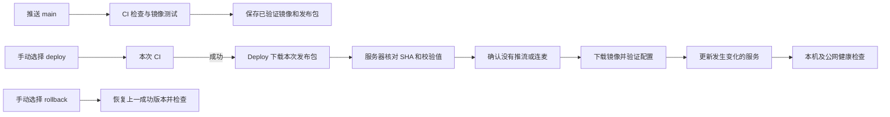

# Streamlab CI/CD：从第一次部署到能在面试中讲清楚

用一次真实的修改理解这套流程：调整直播间页面，推送到 GitHub，先验证生产镜像能播放媒体；停播后手动上线。如果新服务不健康，恢复旧镜像和配置，同时保留录制、证书和同机的 Douyin 站点。

本文包括空白服务器首次安装、已有服务器接入、日常发布、回滚及面试表达。操作速查见 [生产部署说明](DEPLOYMENT.md)。实际线上环境是 Ubuntu 24.04、x86_64，域名为 `live.sunshinedairy.net`。

## 1. 一次发布的主线

CI（持续集成）负责自动验证代码和构建结果；CD 在这里采用持续交付，即准备好可发布的产物，再由人决定上线时间。**推送不会自动部署生产**。



同一个 `.github/workflows/ci.yml` 包含 CI 与 Deploy。`needs: verify` 让部署等待 CI 成功，手动输入 `operation` 决定发布还是回滚。推送产生的已验证镜像还用于首次安装；手动发布会重新跑本次 CI，再部署这次测试过的同一镜像。

job 是工作流中的任务，各自运行在 GitHub 的临时机器上。两个 job 不能依赖对方工作目录还在，因此需要 artifact 保存小型发布包；体积较大的容器镜像放在 GHCR，也就是 GitHub 的容器镜像仓库。

### 怎样读懂“CI 通过才能部署”

完整配置在仓库的 `.github/workflows/ci.yml`。下面只摘录 Deploy 的前置条件，不是独立工作流文件：

```yaml
    needs: verify
    if: >-
      !cancelled() && github.ref == 'refs/heads/main' && github.event_name == 'workflow_dispatch' &&
      ((inputs.operation == 'rollback' && needs.verify.result == 'skipped') ||
       (inputs.operation == 'deploy' && needs.verify.result == 'success'))
```

`needs` 声明任务依赖；`needs.verify.result` 是 CI 的结果。普通发布要求它等于 `success`，同时要求手动触发且分支为 `main`。回滚要求操作为 `rollback`、CI 确实被跳过。`!cancelled()` 避免已取消的运行继续上线，也让回滚可以明确处理被跳过的依赖。

CI 本身通过 `if: inputs.operation != 'rollback'` 决定是否执行。部署密钥只在 Deploy 引用的 Environment 中提供，不通过 PR 检查任务传递。手动操作在点击时确定提交 SHA，后续任务使用这个提交，不随 `main` 的新推送漂移。

推送和手动发布会分别运行 CI，多花一轮检查时间，换来每次发布记录里都能直接找到对应检查和产物；同一次发布的 Deploy 不重复构建。修复发布环境问题后重跑 Deploy，可以复用那次成功 CI 的产物。

## 2. 三个容器怎样分工

```text
浏览器 HTTPS → Caddy（公网 443）
                 ├─ 页面和 API → Next.js Web（127.0.0.1:3000）
                 ├─ /hls/* → MediaMTX 的 HLS（127.0.0.1:8888）
                 └─ WHIP/WHEP → MediaMTX 的 WebRTC（127.0.0.1:8889）
OBS RTMP → MediaMTX（1935）
WebRTC 媒体连接 → MediaMTX（8189）
```

Caddy 是入口，处理 HTTPS 和转发；Web 提供页面、接口及媒体会话控制；MediaMTX 接收、转换和分发媒体。WHIP/WHEP 可以理解为浏览器发布和接收 WebRTC 媒体时使用的协议入口。

与纯静态前端不同，Next.js 需要运行 Node 服务，还要和媒体服务协作，所以本项目交付 Docker 镜像。镜像包含应用及运行依赖，容器是镜像启动后的运行实例。Compose 用一份配置管理三个容器、挂载和运行参数。

`Dockerfile` 分成构建阶段和运行阶段：GitHub 安装依赖并构建 Next.js，最终镜像只携带 standalone 应用、静态资源及 FFmpeg。服务器拉镜像，不在小服务器上执行前端构建。

## 3. 第一次部署前：明确操作位置和已有状态

以下每一步标出执行位置。现有生产机早已运行 Streamlab，本次没有重装 Docker，也没有重新初始化账号。空白服务器分支是根据当前配置编写的安装参考，未在当前主机破坏性重演。

**阿里云网页：**确认服务器公网 IP、Ubuntu 系统、磁盘余量及 x86_64 架构。当前 IP 为 `47.80.28.238`。沿用已有服务器时，先确认哪些服务占用端口，不能直接清理容器或覆盖配置。

**服务器管理员终端，只读：**

```bash
uname -m
cat /etc/os-release
free -h
df -h /
sudo ss -ltnp
sudo docker ps --format '{{.Names}} {{.Image}} {{.Ports}}'
sudo docker compose version
sudo test -f /home/admin/streamlab/state.json && echo '已初始化，跳过首次 bootstrap'
```

发布程序要求至少 2 GiB 可用磁盘。当前小服务器保留已有交换内存；不能把内存不足误判成应用错误。阿里云防火墙需要允许 TCP 80、443、1935、8189 和 UDP 8189，以及管理所需的 SSH 22。3000、8888、8889、9997 等内部接口继续只在回环地址使用，不应直接暴露给公网。

### 3.1 仅空白服务器：安装 Docker 和基础工具

已有 Docker 时跳过。下面采用 [Docker 官方 Ubuntu 软件源](https://docs.docker.com/engine/install/ubuntu/)，不包含卸载已有容器环境的命令：

```bash
sudo apt-get update
sudo apt-get install -y ca-certificates curl python3 openssh-server sudo
sudo install -m 0755 -d /etc/apt/keyrings
sudo curl -fsSL https://download.docker.com/linux/ubuntu/gpg -o /etc/apt/keyrings/docker.asc
sudo chmod a+r /etc/apt/keyrings/docker.asc
sudo tee /etc/apt/sources.list.d/docker.sources >/dev/null <<EOF_DOCKER
Types: deb
URIs: https://download.docker.com/linux/ubuntu
Suites: $(. /etc/os-release && echo "${UBUNTU_CODENAME:-$VERSION_CODENAME}")
Components: stable
Architectures: $(dpkg --print-architecture)
Signed-By: /etc/apt/keyrings/docker.asc
EOF_DOCKER
sudo apt-get update
sudo apt-get install -y docker-ce docker-ce-cli containerd.io docker-buildx-plugin docker-compose-plugin
sudo systemctl enable --now docker
sudo docker compose version
```

### 3.2 DNS 和 HTTPS 的前置条件

阿里云 DNS 控制台打开 `sunshinedairy.net`，配置：

```text
记录类型：A
主机记录：live
记录值：47.80.28.238
```

保留其他已有记录。**本机终端：**

```bash
dig +short live.sunshinedairy.net A
```

预期指向服务器。Caddy 启动后会自动申请和续期证书，需要 DNS 正确且公网 80/443 可达。域名解析正确不代表应用已经启动；证书成功也不代表媒体链路已经通过检查。

### 3.3 本机准备仓库和第一次 CI 镜像

本机需要 Git、Node 24、Corepack 和 GitHub CLI。新环境克隆仓库：

```bash
git clone https://github.com/woyaofei303/streamlab.git
cd streamlab
corepack enable
pnpm --version
pnpm install --frozen-lockfile
pnpm exec next typegen
pnpm lint
pnpm typecheck
pnpm test
pnpm test:deploy
gh auth login
```

`package.json` 固定 pnpm 11.21.0。`next typegen` 生成路由类型，随后类型检查才能使用这些生成文件。当前独立维护目录是 `/Users/julian/streamlab-ci-production`；已有目录直接进入，不要覆盖原目录中的未提交修改。

仓库 `.github/workflows/ci.yml` 推送到 `main` 后，GitHub 会自动执行 CI：代码检查、类型检查、单元测试、部署故障测试、生产镜像构建、SEO 及隔离媒体测试。CI 的推流密码是临时生成的，合成视频和假摄像头只连接临时容器，不在生产服务器开播。

第一次需要把 GitHub Packages 中的 `streamlab` 镜像包明确设置为 Public，服务器才能匿名拉取。仓库公开不等于镜像包自动公开。后续 CI 使用 GitHub 提供的短期 `GITHUB_TOKEN` 写入 GHCR，不需要把个人长期 Token 放进源码。

本机下载**当前提交**已成功 CI 的发布包：

```bash
set -eu
task_revision=$(git rev-parse HEAD)
task_run=$(gh run list --repo woyaofei303/streamlab --workflow ci.yml --branch main --event push --commit "$task_revision" --status success --limit 1 --json databaseId --jq '.[0].databaseId')
test -n "$task_run" && test "$task_run" != null
mkdir -p output-tdd/first-release
gh run download "$task_run" --repo woyaofei303/streamlab --name "release-$task_revision" --dir output-tdd/first-release
python3 deploy/package-release.py verify "$task_revision" - output-tdd/first-release
```

找不到成功运行时，先处理 CI，不用其他提交的包替代。最后命令返回包的校验值；`release.json` 记录提交 SHA 和镜像 digest。digest 是镜像内容的标识，生产按它下载，不依赖会移动的 `latest` 标签。发布包只包含 Compose、Caddy、MediaMTX 配置及清单，不包含运行时密码。

### 3.4 仅空白服务器：先启动可接管的初始站点

现有 `bootstrap.sh` 的职责是**接管一套已经正常运行的服务**，不能直接在空目录上运行。空白服务器要先完成这一节；已有正常运行的 `streamlab-*` 容器则跳到下一节。

本机用已有管理员通道上传脚本、公有配置包和环境模板；以下管理员账号、密钥路径替换为实际值：

```bash
ssh -i /path/to/admin-key admin@47.80.28.238 'mkdir -p /tmp/streamlab-first'
scp -i /path/to/admin-key deploy/deploy.py deploy/package-release.py deploy/bootstrap.sh deploy/.env.example output-tdd/first-release/release.tgz output-tdd/first-release/release.json admin@47.80.28.238:/tmp/streamlab-first/
```

服务器管理员终端先进入 root shell：

```bash
sudo -i
```

以下只适用于未部署过 Streamlab 的空目录，检查失败就停止：

```bash
set -eu
test ! -e /home/admin/streamlab
mkdir -p /home/admin/streamlab/deploy
cd /home/admin/streamlab
install -m 755 /tmp/streamlab-first/deploy.py /tmp/streamlab-first/package-release.py /tmp/streamlab-first/bootstrap.sh deploy/
task_revision=$(python3 -c 'import json; print(json.load(open("/tmp/streamlab-first/release.json"))["revision"])')
python3 deploy/package-release.py verify "$task_revision" - /tmp/streamlab-first
tar -xzf /tmp/streamlab-first/release.tgz -C deploy
umask 077
{
  printf 'DOMAIN=live.sunshinedairy.net\nPUBLIC_IP=47.80.28.238\n'
  printf 'PUBLISH_PASSWORD='
  openssl rand -hex 24
  python3 -c 'import json; print("WEB_IMAGE=" + json.load(open("/tmp/streamlab-first/release.json"))["image"])'
} > deploy/.env
docker compose --project-name streamlab --env-file deploy/.env -f deploy/compose.yml config --quiet
docker compose --project-name streamlab --env-file deploy/.env -f deploy/compose.yml pull
docker compose --project-name streamlab --env-file deploy/.env -f deploy/compose.yml up -d --wait --wait-timeout 120
curl --fail http://127.0.0.1:3000/api/health
curl --fail https://live.sunshinedairy.net/api/health
```

先验证归档，再解压，避免使用未经检查的配置。密码直接写入服务器文件，没有输出到终端。不要把 `deploy/.env` 提交到 Git，也不要将展开后的 `docker compose config` 打印到公共日志；它可能包含密码。`config --quiet` 只验证配置。

预期三个容器运行，两个健康地址返回 `status: ok`，`revision` 与包中的提交 SHA 相同。若 GHCR 返回拒绝访问，检查包是否公开；若本机健康成功而 HTTPS 失败，检查 DNS、80/443 和 Caddy 日志。解决后再做接管，不能把故障状态保存为可靠回滚版本。

### 3.5 为 GitHub 建立受限部署通道

本机生成专用 SSH 密钥。存在同名文件时先检查复用，不覆盖：

```bash
install -d -m 700 ~/.ssh
test ! -e ~/.ssh/streamlab-deploy && \
  ssh-keygen -t ed25519 -N '' -f ~/.ssh/streamlab-deploy -C streamlab-production
scp -i /path/to/admin-key ~/.ssh/streamlab-deploy.pub admin@47.80.28.238:/tmp/streamlab-deploy.pub
```

私钥留在本机与 GitHub Secret，服务器只接收 `.pub` 公钥。

在**服务器管理员终端**确认没有推流、没有开放的连麦会话，然后运行一次性接管：

```bash
sudo bash /home/admin/streamlab/deploy/bootstrap.sh /tmp/streamlab-deploy.pub
```

脚本会检查现状、备份源码和配置，给正在运行的镜像保留本地标签，记录 `bootstrap` 版本，创建共享配置目录、普通部署账号、受限 SSH 入口和精确 sudo 规则。正在运行的容器不会在这一步重启。

预期出现 `Initialization complete`，并存在 `state.json` 与 `/usr/local/lib/streamlab/deploy.py`。脚本拒绝重复初始化，部分失败后先检查已完成部分，不能反复盲跑。已有 `state.json` 的服务器不要重跑 bootstrap；入口脚本升级需另行备份、校验和安装。

这里的 SSH 权限与 Douyin 不同：Streamlab 的部署用户不能任意执行 shell。它只能请求 `deploy <SHA> <校验值>` 或 `rollback`，由 root 持有的 Python 入口验证、执行 Docker 操作。不是把整个 Docker 管理权限直接交给 CI。

### 3.6 验证服务器身份并保存到 GitHub

在阿里云可信管理员终端读取主机指纹：

```bash
sudo ssh-keygen -lf /etc/ssh/ssh_host_ed25519_key.pub
```

本机采集并对照：

```bash
ssh-keyscan -t ed25519 47.80.28.238 > /tmp/streamlab-host-key
ssh-keygen -lf /tmp/streamlab-host-key
```

确认一致后才保存：

```bash
install -m 600 /tmp/streamlab-host-key ~/.ssh/streamlab_known_hosts
```

客户端私钥证明“谁来发布”，主机指纹证明“发布到哪台机器”，不能混为一个认证步骤。

GitHub 网页打开 Settings → Environments，新建 `production`，允许部署分支限定为 `main`。本机录入配置：

```bash
gh variable set DEPLOY_HOST --repo woyaofei303/streamlab --env production --body '47.80.28.238'
gh secret set DEPLOY_SSH_KEY --repo woyaofei303/streamlab --env production < ~/.ssh/streamlab-deploy
gh secret set DEPLOY_KNOWN_HOSTS --repo woyaofei303/streamlab --env production < ~/.ssh/streamlab_known_hosts
```

密钥通过标准输入传输，不显示在命令行参数或终端输出中。[GitHub Environment](https://docs.github.com/en/actions/how-tos/deploy/configure-and-manage-deployments/manage-environments) 将生产配置限定给引用该环境的部署任务。

### 3.7 第一次由工作流正式接管发布

确认停播并关闭连麦。在 Actions → CI & Production → Run workflow 中选 `main`、`deploy`。或者本机执行：

```bash
gh workflow run ci.yml --repo woyaofei303/streamlab --ref main -f operation=deploy
gh run list --repo woyaofei303/streamlab --workflow ci.yml --limit 5
```

CI 重新验证并保存镜像，Deploy 下载本次发布包并核对提交，然后通过受限 SSH 入口发布。服务器先检查直播状态，再校验包大小、文件白名单、提交 SHA、内容校验值和镜像 digest；下载完成后再检查一次直播状态，避免等待下载期间有人开播。

首次从 `bootstrap` 切换到正式版本可能重建三个服务，应在停播窗口执行。后续只重建镜像或配置发生变化的服务，普通 Web 更新不需要重启媒体和代理。

成功时运行摘要出现 `DEPLOY_OK`，标明提交、更新服务及健康检查。验证公网：

```bash
curl --fail https://live.sunshinedairy.net/api/health
```

预期状态正常且提交 SHA 与这次发布一致。HTTP 200 只是基础检查，CI 还针对同一生产镜像验证了 RTMP/HLS、浏览器发布和四人合流的媒体链路。

## 4. 版本、运行数据和密码为什么分开

```text
/home/admin/streamlab/
  releases/<提交号>-<包校验值前12位>/   已验证配置和镜像标识
  releases/bootstrap/                 初次接管前的版本
  shared/runtime.env                  运行时密码和域名等，0600
  shared/config/                      容器实际读取的配置
  shared/extra-sites.caddy             同机其他站点的管理员配置
  state.json                          current、previous 和历史版本
  pending.json                        未完成发布的恢复记录
  backups/                            首次接管备份
  logs/deployments.jsonl               发布审计日志
```

版本目录描述“运行哪套程序和配置”，运行时文件描述“这个环境使用什么密码和域名”，Docker 卷保存录制与证书。这三类内容不能混在一个随发布覆盖的目录里。

发布前写 `pending.json`，记录从哪版切到哪版、哪些服务会更新。成功后更新 `state.json` 并清除 pending；失败则恢复旧镜像、旧配置和状态。如果恢复也失败，保留 pending 并拒绝新发布，等待管理员恢复，避免在状态不明时继续覆盖。

程序保留最近三个成功版本，并保护 `bootstrap`；镜像清理按精确引用操作，不执行全局 `docker system prune` 或 `down -v`。应用回滚不会撤销已发生的用户操作，也不是录制数据的备份恢复。

## 5. 为什么新增 Douyin 会影响这里

`dy.sunshinedairy.net` 和 `live.sunshinedairy.net` 使用同一台机器的 Caddy。Douyin 自己有 Nginx、发布账号、目录和 8088 端口，但公网入口共用一个代理进程。

只在当前 Caddyfile 追加 `dy` 会留下问题：Streamlab 的下一次发布或回滚会安装版本包中的 Caddyfile，将额外站点删掉。现在管理员把其他站点单独放在：

```text
/home/admin/streamlab/shared/extra-sites.caddy
```

```caddyfile
dy.sunshinedairy.net {
    encode zstd gzip
    reverse_proxy 127.0.0.1:8088
}
```

`config_content()` 将目标版本配置与这个文件合并；`validate()` 验证合并后的实际配置；`install_config()` 安装同一份内容。回滚和失败恢复也走这条路径，因此不修改原版本包、不破坏校验值，也不会撤销其他站点。

已有服务器需要管理员备份并升级已安装的 `/usr/local/lib/streamlab/deploy.py`。应用工作流不能自行替换这个 root 入口。额外配置文件由 root 管理；新增或修改片段后，要走配置验证和受控发布。代理配置或镜像变化需要重建代理时，两个域名仍可能同时短暂受影响，这不是两台完全独立的服务器。

## 6. 日常回滚和故障恢复

在同一个工作流选 `rollback`：

```bash
gh workflow run ci.yml --repo woyaofei303/streamlab --ref main -f operation=rollback
```

CI 被跳过，服务器取 `state.json` 的 `previous`。回滚仍检查是否在直播、配置是否有效、旧镜像是否可用，以及本机和公网的版本是否匹配。没有上一版本时会拒绝，不会删除当前版本。

新版本启动或健康检查失败时，程序自动恢复旧版本；正常的人工回滚使用相同保护。回滚后继续发布新版本，再手动选择 `deploy`。GitHub 和服务器各有并发控制，避免两个发布同时切换状态；等待中的操作可能被新的等待请求替换，不要连续堆积点击。

常见故障按边界定位：

- **CI 红灯：**查看第一个失败步骤，Deploy 不运行；不要绕过镜像媒体测试。
- **没有成功产物：**确认是本次 CI 的 artifact；过期后重新运行完整流程。
- **GHCR 无法拉取：**确认包公开、网络和磁盘空间；下载失败发生在切换之前。
- **提示正在直播或连麦：**先真正停播并关闭会话，再手动重试；查询失败也会阻止发布。
- **`DEPLOY_FAILED_ROLLED_BACK`：**新版本失败，但旧版本已恢复且健康检查通过，修复后再发布。
- **`ROLLBACK_FAILED` 或遗留 pending：**管理员检查服务状态和日志，使用下面的恢复入口；不要手工删除 pending 来跳过保护。

服务器管理员终端：

```bash
sudo docker ps --filter name=streamlab-
sudo docker logs --tail=100 streamlab-web-1
sudo docker logs --tail=100 streamlab-proxy-1
sudo streamlab-deploy recover
```

`recover` 根据 pending 中的旧状态恢复，用于中断或恢复失败；先检查现场并安排停播。它不依赖故障新应用上报空闲，因此不能作为日常发布入口。

## 7. 面试时怎样组织表达

先说问题，再说约束和结果：

> 我给一个 Next.js 直播演示项目搭建了单机 CI/CD。它除了页面还依赖媒体服务，因此 CI 不只做编译，而是构建生产镜像后，用临时容器、合成视频和假摄像头验证播放、浏览器发布及合流。生产由同一工作流手动触发，CI 成功后只交付测试过的镜像 digest 和校验过的配置包。服务器通过受限 SSH 入口操作，发布前后检查直播状态，只更新变化的服务，并验证本机和公网的实际版本。失败恢复旧镜像及配置，恢复失败则保留日志和状态，禁止继续发布。

追问时说明设计原因：

- **为什么不是在服务器 git pull 再 build？** 构建会抢占小服务器资源，也可能在生产重新生成与测试不同的产物；这里将构建集中在 CI。
- **为什么用 digest？** 标签可以移动，digest 对应确定的镜像内容；配置包还独立校验 SHA-256，防止镜像与配置错配。
- **为什么部署前检查两次直播状态？** 下载镜像可能花时间，第一次检查后仍可能有人开播；切换前必须再确认。
- **为什么有 pending？** 文件替换和容器重建不是一个数据库事务，进程可能中途退出；恢复记录保留足够信息，让下一次操作知道应该回到哪里。
- **为什么回滚不先跑当前 CI？** 它恢复已成功运行的旧版本，不能让故障提交的检查阻断恢复；但线上空闲和健康检查仍保留。
- **为什么普通账号还需要 root 入口？** Docker 操作需要较高权限，因此只开放精确命令，由管理员脚本验证输入；不能给流水线任意 root shell。
- **是否零停机、高可用？** 这是单机 Compose 方案，重建服务有短暂维护窗口，直播中的连接也不能靠代码回滚复原。多机、容量和灾难恢复需要另行设计。

对应源码：`.github/workflows/ci.yml` 定义门槛和入口；`Dockerfile` 定义交付镜像；`deploy/package-release.py` 打包及验证配置；`deploy/deploy.py` 管理切换、直播保护、回滚与恢复；`deploy/bootstrap.sh` 安装受限账号；`tests/test_deploy.py` 验证故障分支；`playwright.ci.config.ts` 和 `tests/e2e/production.spec.ts` 验证生产镜像的媒体链路。

## 8. 本次实际验证与边界

2026-10-20 的实际记录：

- [手动 CI → Deploy 成功，并成功重跑 Deploy 恢复最新版](https://github.com/woyaofei303/streamlab/actions/runs/39394022224)。线上应用提交为 `fb2ac6fc3b8406c9a1dbe0d77de306b5b6f5e845`。
- [工作流回滚成功](https://github.com/woyaofei303/streamlab/actions/runs/39394896716)：CI 跳过，线上健康接口确认恢复到之前的 `203fbd1`；随后恢复最新版。
- 推送 CI 成功，Deploy 跳过；Actions 只保留一个有效工作流。
- Biome、TypeScript 检查通过；43 个单元测试通过、2 个条件测试跳过；14 个 Python 部署测试通过。
- CI 中 3 个生产镜像媒体用例及 SEO 检查通过，覆盖 RTMP/HLS、浏览器发布和四人合流。
- 管理员入口升级前后四个现有容器启动时间相同；本次应用发布记录只更新 Web 服务。
- 发布、回滚和恢复期间再次检查，`dy.sunshinedairy.net` 继续返回正确版本。
- 旧管理员入口与 Caddyfile 备份在 `/root/douyin-deploy-backups/20261020/streamlab-entrypoint/`。

没有在生产主动开播来制造阻断条件；直播拒绝、故障恢复和额外站点保留由部署测试覆盖，媒体测试运行在 CI 的隔离容器。没有进行空白主机重装、真实并发容量测试或主机灾难恢复演练。

面试中可以据此讲已实现、已验证的部分。不要把本次 CI 的三条媒体用例说成全部浏览器测试，也不要把空白服务器安装参考说成已经在当前生产机重装演练。
